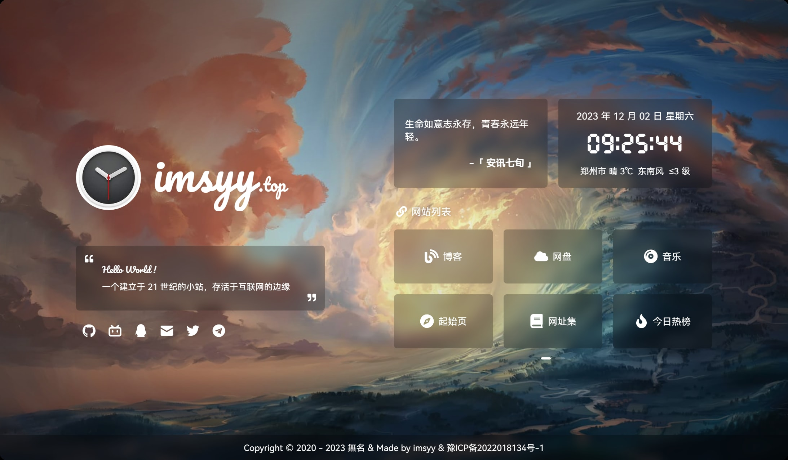
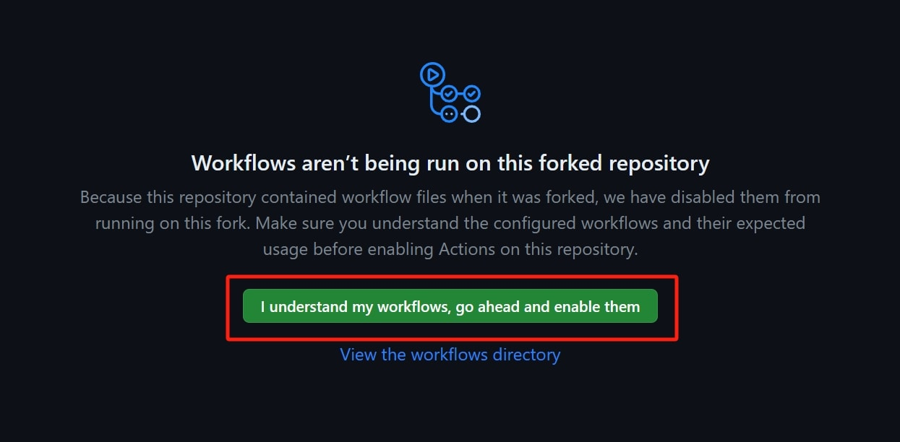
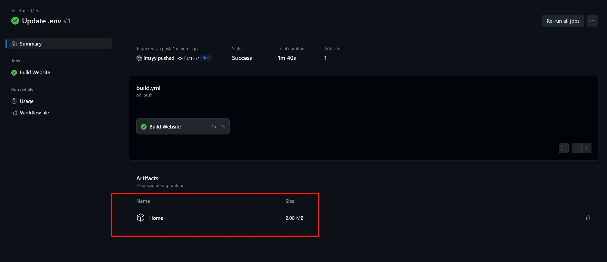

简体中文 | [English](./README_EN.md)

<p>
<strong><h2>無名の主页</h2></strong>
简单的小主页，原来的看够了，重新弄了一个
</p>



>主页的 Logo 字体已经过压缩，若用本站 Logo 以外的字母会变回默认字体，这里是 [完整字体](https://file.imsyy.top/font/Other/Pacifico-Regular.ttf)，若无法下载，可将字体目录下的 `Pacifico-Regular-all.ttf` 进行替换

### Demo

>由于 CDN 缓存原因，查看最新效果可能需要 `Ctrl` + `F5` 强制刷新浏览器缓存

- [無名の主页](https://www.imsyy.top)
- [無名の主页 - Dev](https://home-imsyy.vercel.app)
- [無名の主页 - 备用线路](https://home-5iw.pages.dev)

### 功能

- [x] 载入动画
- [x] 站点简介
- [x] Hitokoto 一言
- [x] 日期及时间
- [x] 实时天气
- [x] 时光进度条
- [x] 音乐播放器
- [x] 移动端适配

### 自动部署

如果遇到构建环境或者打包过程出现错误，则可以采用 `Github Actions` 来进行自动构建

- 在成功 `fork` 仓库后，前往 `Actions` 页面，若您是首次开启，则会出现下面的提示，点击开启
  
  

- 然后在仓库中进行任意修改后均会触发工作流的运行，在工作流完成后，会在下方生成一个可供下载的压缩包，这就是构建出的静态文件，可自行上传至服务器
  
  

### 手动部署

* **安装** [node.js](https://nodejs.org/zh-cn/) **环境**

  > Node.js 22.13+ 或 24+，推荐 24.x；统一使用 npm 和 `package-lock.json`
  
* 然后以 **管理员权限** 运行 `cmd` 终端，并 `cd` 到 项目根目录
* 在 `终端` 中输入：

```bash
# 安装依赖
npm ci

# 预览
npm run dev

# 构建
npm run build
```
> 构建完成后，静态资源会在 **`dist` 目录** 中生成，可将 **`dist` 文件夹下的文件**上传至服务器，也可使用 `Vercel` 等托管平台一键导入并自动部署

### Docker 部署

> 安装及配置 Docker 将不在此处说明，请自行解决

```bash
# 构建
docker build -t home .
# 运行
docker run -p 12445:12445 -d home
```

### 网站链接

在 `src/assets/siteLinks.json` 中可以自定义网站链接（以指向自己的网站）:

```json
{
  "icon": "Blog",						
  "name": "博客",						
  "link": "https://blog.imsyy.top/"	
},
```

其中 `icon` 网站链接的图标可以在 `src/components/Links/index.vue` 中添加:

```js
// 可前往 https://www.xicons.org 自行挑选并在此处引入
// 此处引入的是 fa 类型
import {
  Link,
  Blog,
  CompactDisc,
  Cloud,
  Compass,
  Book,
  Fire,
  LaptopCode,
} from "@vicons/fa";

...

// 网站链接图标
const siteIcon = {
  Blog,
  Cloud,
  CompactDisc,
  Compass,
  Book,
  Fire,
  LaptopCode,
};
```

### 社交链接

在 `src/assets/socialLinks.json` 中可以自定义社交链接。

### 天气

天气及地区获取需要 `高德开放平台` 相关 API

- 前往 [高德开放平台控制台](https://console.amap.com/dev/index) 创建一个 `Web 服务` 类型的 `Key`，并将 `Key` 填入 `.env` 中的 `VITE_WEATHER_KEY` 中

也可自行更换其他方式


### 音乐

>本项目采用了基于 `MetingJS` 的 `Aplayer` 音乐播放器，可实现快速自定义歌单  
>*仅支持 **中国大陆地区**

请在 `.env` 文件中更改歌曲相关参数即可实现自定义歌单列表

```bash
# 歌曲 API 地址
VITE_SONG_API = "https://api-meting.imsyy.top"
# 歌曲服务器 ( netease-网易云, tencent-qq音乐 )
VITE_SONG_SERVER = "netease"
# 播放类型 ( song-歌曲, playlist-播放列表, album-专辑, search-搜索, artist-艺术家 )
VITE_SONG_TYPE = "playlist"
# 播放 ID
VITE_SONG_ID = "7452421335"
```

#### 兼容 Linyu 的上游音源

保留默认的 Meting 模式。需要复用 `D:/code/front/linyu` 的音源时，将 [.env.music.example](./.env.music.example) 中所需配置合并到项目根目录的 `.env.local`（若该文件已有配置请保留），然后重启开发服务：

```dotenv
VITE_SONG_PROVIDER=linyu
LINYU_ENV_FILE=D:/code/front/linyu/.env
MUSIC_PLAYLIST_FILE=./music.example.json
```

`LINYU_ENV_FILE` 只读取 `MUSIC_API_URL`、`MUSIC_API_KEY`、`MUSIC_QUALITIES` 三个变量，不启动 Linyu，也不读取它的账号、数据库和 AI 设置。主页 `.env.local` / 环境变量中同名设置优先。若音源仅保存在 Linyu 管理后台的加密配置中，请由管理员单独提供这三个服务端变量；这里不会自动解密后台配置。

主页歌单使用 [music.example.json](./music.example.json) 的格式，可复制为自己的 JSON 文件并修改 `MUSIC_PLAYLIST_FILE`。每首歌曲填写 `source`、`songId`、`name`、`artist`，可选填 `cover`（HTTP/HTTPS URL）、`lrc`（LRC 正文或公开歌词 URL）、`quality`。最多 200 首；歌词不会自动从 Linyu 曲库同步，未填写时显示暂无歌词。

| 平台 | source | songId |
| --- | --- | --- |
| 网易云 | `wy` | 歌曲 ID |
| QQ 音乐 | `tx` | songmid |
| 酷我 | `kw` | rid |
| 酷狗 | `kg` | 基本 hash |
| 咪咕 | `mg` | 内部 songId，非 copyrightId |

默认优先 `320k`，未开放时使用该平台音质表的第一项；也可设置 `MUSIC_QUALITY` 或每首歌曲的 `quality`。显式指定的音质必须在音源开放列表内，空平台列表表示停用。实际播放权限仍由上游决定。

开发和 `npm run preview` 已内置同域 `/api/music/*` 适配。生产环境运行：

```sh
npm ci
npm test
npm run lint
npm run build
npm start
```

默认监听 `127.0.0.1:12445`，可通过 `HOST`、`PORT` 调整。反向代理需要将 `/api/music/*` 也转发给这个 Node 服务。该模式需要服务端运行环境；仅上传 `dist` 到纯静态托管不能解析音源，纯静态部署继续使用 Meting。

部署时直接提供 `MUSIC_API_URL`、`MUSIC_API_KEY`、`MUSIC_QUALITIES`，并上传主页歌单，无需依赖服务器上另一个 Linyu 项目的目录。**音源 Key 不要使用 `VITE_` 前缀**。上游音源 API 要求 HTTPS；HTTPS 音频由浏览器直接访问，HTTP 音频通过主页服务端流式转发，保留 Range / 206，不将整首歌曲读入内存。转发只允许公网地址并逐次校验重定向，实际连接固定到校验过的 DNS 地址；包含音源 Key 的播放链接会被拒绝。接口只解析配置歌单内的曲目，临时播放链接缓存 30 秒后重新获取；不复用 Linyu 的登录会话和受保护音频中转。

Docker 中使用该模式：

```sh
docker build --build-arg VITE_SONG_PROVIDER=linyu -t home .
docker run --env-file .env.local -p 12445:12445 -d home
```

容器环境应在 `.env.local` 直接填写服务端音源变量，移除本机 `LINYU_ENV_FILE` 路径。自定义歌单需挂载到容器，并让 `MUSIC_PLAYLIST_FILE` 指向挂载路径。`VITE_SONG_PROVIDER` 是构建时设置，切换模式后需要重新构建。

### 字体

现采用 `HarmonyOS Sans` 开源字体，采用字体拆分，提升加载速度

>由于本站 `CDN` 已开启防盗链，**非本站域名不可访问**，请将字体引入链接更改为下方内容，否则 **自定义字体将失效**
>
>`https://s1.hdslb.com/bfs/static/jinkela/long/font/regular.css`

<details>
<summary>旧版方式</summary>

>由于本项目引入了中文字体，需要压缩中文字体以提高网页加载速度（ 也可以取消使用中文字体 ）

#### 中文字体去除繁体

- 安装 `Python 3.7` 和 `pip`
- 运行 `pip install fonttools`
- 下载 [sc_unicode.txt](https://gist.githubusercontent.com/imaegoo/d64e5088b723c2e02c40985f55ff12db/raw/5ebd2ce49418c73459a9dfe050483409306a6c1d/sc_unicode.txt)
- 运行 `pyftsubset 字体名称.ttf --unicodes-file=sc_unicode.txt`

#### 字体进一步压缩

- 编译安装 `Google woff2`

```bash
sudo apt-get install -y git g++ make
git clone --recursive https://github.com/google/woff2.git
cd woff2
make clean all
```

- 再压缩字体

```
./woff2_compress ./字体名称.ttf
```

- 最终可对原字体进行缓加载，**先行加载压缩后的字体**

>详细信息可前往 [虹墨空间站](https://www.imaegoo.com/2020/chinese-font-compress/) 查看原文

</details>

### 网站图标及网站背景

#### 网站背景

可以在 `public/images` 中修改网站背景

如果想要添加更多的本地图片作为网站背景，可以将图片重命名 `background+数字` 的形式，并在 `src/components/Background/index.vue` 中进行修改：

```js

if (type == 0) {
  // 修改此处 Math.random() 后面的第一个数字为图片的数量
  bgUrl.value = `/images/background${Math.floor(
    Math.random() * 10 + 1
  )}.webp`;
}
```

#### 网站图标

可以在 `public/images/icon` 中修改网站图标。

### 技术栈

* [Vue](https://cn.vuejs.org/)
* [Vite](https://vitejs.cn/vite3-cn/)
* [Pinia](https://pinia.vuejs.org/zh/)
* [IconPark](https://iconpark.oceanengine.com/official)
* [xicons](https://xicons.org/)
* [Aplayer](https://aplayer.js.org/)

### API

* [小歪 API](https://api.aixiaowai.cn)
* [搏天 API](https://api.btstu.cn/doc/sjbz.php)
* [教书先生 API](https://api.oioweb.cn/doc/weather/GetWeather)
* [高德开放平台](https://lbs.amap.com/)
* [Hitokoto 一言](https://hitokoto.cn/)

## Star History

[](https://star-history.com/#imsyy/home&Date)

<a title="SSL" target="_blank" href="https://myssl.com/seal/detail?domain=blog.imsyy.top"></a>&nbsp;<a title="CDN" target="_blank" href="https://cdnjs.com/"></a>&nbsp;<a title="Copyright" target="_blank" href="https://imsyy.top/"></a>
